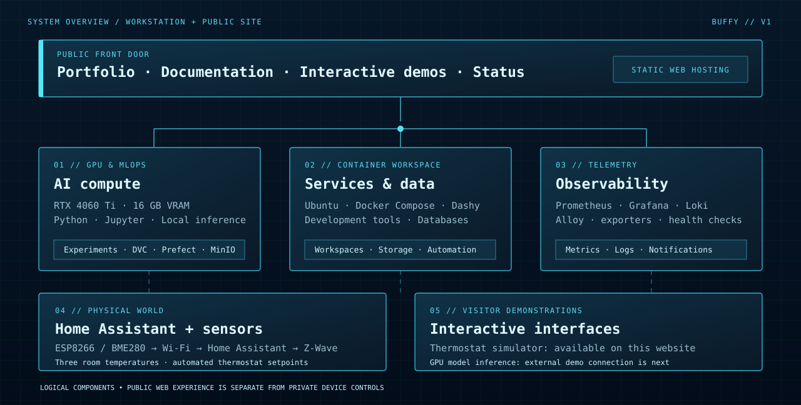

# Platform architecture

Buffy is a single powerful Linux workstation doing several different jobs. Instead of treating everything as one giant application, I organize the setup by **purpose, isolation, and observability**.

> The diagram is a conceptual view of the platform. It explains the relationships between components rather than exposing internal device addresses or administration interfaces.

## The four major subsystems

### 1. GPU compute and research

The RTX 4060 Ti (16 GB) provides a dedicated place to run AI workloads locally. Python environments, Jupyter notebooks, experiment artifacts and model-serving software can be developed and tested without provisioning a cloud GPU for every iteration.

### 2. Containerized software and data

Docker Compose makes it possible to run distinct development tools, databases, document-processing services, and automation software side by side. Dashy is my private service launcher; Portainer helps manage containers and stacks. Persistent volumes keep important application state separate from short-lived containers.

### 3. Telemetry and reliability

Prometheus gathers metrics, Grafana helps visualize them, and Loki collects application and container logs. Alloy, Node Exporter, cAdvisor, Beszel, Dozzle, Uptime Kuma and ntfy cover different parts of the operational story.

This helps answer questions such as: *Is the host overloaded? Which service is failing? Did a deployment cause a new error?*

### 4. Smart home and physical devices

Home Assistant coordinates a Honeywell T6 Pro Z-Wave thermostat and custom ESP8266/BME280 sensor nodes. ESPHome handles microcontroller firmware and network reporting; Z-Wave JS UI connects the thermostat to the host through a Zooz radio controller.

The **thermostat itself remains the primary equipment controller**. Home Assistant supervises its requested setpoint; it does not replace the furnace's safety hardware.

## How the public site fits in

The website, documentation, thermostat simulation, and status page can be hosted as static files on GitHub Pages. They do **not** require a visitor to connect to Buffy or Home Assistant.

The GPU demo is intentionally separate. When it goes live, only a dedicated, constrained application interface—not the Docker dashboard or model-serving API—will be accessible to visitors.

## Why this separation matters

A useful homelab must remain useful even when public hosting is unavailable. The public showcase communicates how the system works; the private network continues to run the experiments and home automations.
